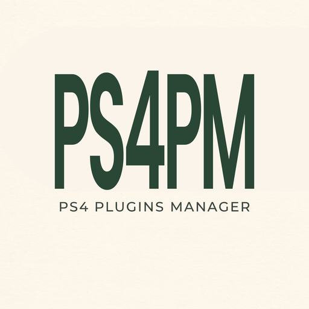
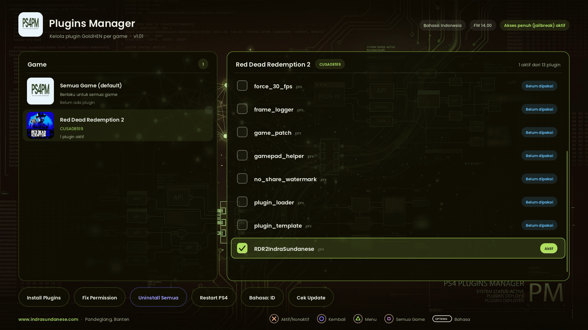

<p align="center">
  
</p>

<h1 align="center">PS4 Plugins Manager</h1>

<p align="center">
  Kelola plugin GoldHEN per game langsung dari PS4 — tanpa FTP, tanpa edit <code>plugins.ini</code> manual.<br>
  <i>Manage GoldHEN plugins per game right on your PS4 — no FTP, no manual <code>plugins.ini</code> editing.</i>
</p>

<p align="center">
  
  
  
</p>

<p align="center">
  <a href="#-bahasa-indonesia">🇮🇩 Bahasa Indonesia</a> · <a href="#-english">🇬🇧 English</a>
</p>

<p align="center"></p>

---

## 🇮🇩 Bahasa Indonesia

### Fitur

| Fitur | Keterangan |
|---|---|
| **Daftar game + icon** | Menampilkan game terinstal (icon, judul, CUSA) yang punya plugin di `plugins.ini`, plus entri **Semua Game (default)**. Tekan **□** untuk menampilkan semua game terinstal. |
| **Enable / Disable plugin** | Centang = aktif. Disable → baris dihapus dari `plugins.ini` dan file di-rename jadi `NAMA.prx.disable`. Enable → file di-rename kembali dan baris ditulis ulang. Section game dibuat otomatis jika belum ada. |
| **Deteksi plugin baru** | Setiap `.prx` baru di folder `plugins` otomatis muncul (belum tercentang sampai ditulis ke `plugins.ini`). |
| **Status** | **Aktif**, **Aktif (default)**, **Nonaktif**, **Nonaktif (.disable)**, **Belum dipakai**, **File tidak ada**. |
| **Install Plugins** | Untuk PS4 yang benar-benar kosong: unduh plugin dari server indrasundanese.com, buat `plugins.ini`, **fix permission otomatis**, lalu restart PS4. `plugins.ini` yang sudah ada tidak ditimpa. |
| **Fix Permission** | Set permission `0777` untuk `/data/GoldHEN`, folder `plugins`, dan `plugins.ini`. |
| **Uninstall Semua** | Hapus folder `plugins`, `plugins.ini`, dan data buatan plugin di `/data` (mis. `AFR`, `frame_logger`, `gamepad.ini`, `patches/settings`). Folder `cheats` & `patches/xml` **tidak** disentuh. |
| **Restart PS4** | Restart langsung dari app. |
| **Notifikasi update** | Saat online, app mengecek rilis terbaru di GitHub dan memberi tahu jika ada versi baru. |
| **2 Bahasa** | Bahasa Indonesia & English (tombol **OPTIONS**). |
| **Aman** | Tidak pernah menimpa `plugins.ini` yang gagal dibaca. Plugin yang masih dipakai game lain tidak di-rename. |

### Persyaratan
- PS4 dengan **HEN aktif** (disarankan **GoldHEN 2.x**), semua firmware yang bisa HEN.
- Koneksi internet hanya untuk **Install Plugins** dan **cek update**.

### Instalasi
1. Unduh `Plugins_Manager_vX.XX.pkg` dari halaman [Releases](../../releases/latest).
2. Copy ke USB / kirim lewat Remote PKG, lalu install lewat **Debug Settings → Package Installer** atau **GoldHEN Package Installer**.
3. Jalankan GoldHEN, lalu buka **Plugins Manager**.

> **Update:** jika app memberi notifikasi versi baru, unduh PKG terbaru dari Releases lalu install ulang (data & pengaturan tetap aman).

### Kontrol

| Tombol | Fungsi |
|---|---|
| ↑ ↓ | Kursor (tahan untuk scroll cepat) |
| ← → | Pindah panel Game ↔ Plugin |
| ✕ | Pilih / Aktifkan–Nonaktifkan plugin |
| ○ | Kembali |
| △ | Buka menu bawah (Install, Fix Permission, Uninstall, Restart, Bahasa, Cek Update) |
| □ | Tampilkan semua game terinstal |
| L1 / R1 | Lompat 6 baris |
| OPTIONS | Ganti bahasa |

### Cara kerja `plugins.ini`

```ini
[default]                                  ; berlaku untuk semua game
/data/GoldHEN/plugins/game_patch.prx

[CUSA08519]                                ; khusus game ini
/data/GoldHEN/plugins/RDR2IndraSundanese.prx
```

Disable `RDR2IndraSundanese` di CUSA08519 → barisnya dihapus dan file menjadi `RDR2IndraSundanese.prx.disable` (jika tidak dipakai game lain). Enable lagi → semuanya dikembalikan.

### FAQ
- **Perubahan plugin kapan berlaku?** Saat game dijalankan berikutnya. Restart hanya dibutuhkan setelah Install/Uninstall.
- **Status "Akses penuh" gagal?** Pastikan GoldHEN sudah dijalankan sebelum membuka app.
- **Plugin saya tidak muncul?** Pastikan file berakhiran `.prx` dan ada di `/data/GoldHEN/plugins/`.

---

## 🇬🇧 English

### Features
-  **Game list with icons** — installed games (icon, title, CUSA) that have plugins in `plugins.ini`, plus an **All Games (default)** entry. Press **□** to list every installed game.
-  **Enable / Disable** — disabling removes the line from `plugins.ini` and renames the file to `NAME.prx.disable`; enabling renames it back and re-adds the line. Missing game sections are created automatically.
-  **New plugin detection** — any new `.prx` in the `plugins` folder shows up unchecked until it is written to `plugins.ini`.
-  **Install Plugins** — for a clean PS4: downloads plugins from the indrasundanese.com server, creates `plugins.ini`, **fixes permissions automatically** and offers a restart.
-  **Fix Permission** — sets `0777` on `/data/GoldHEN`, the `plugins` folder and `plugins.ini`.
-  **Uninstall All** — removes the `plugins` folder, `plugins.ini` and data created by plugins in `/data`. `cheats` and `patches/xml` are kept.
-  **Restart PS4**, **update notifications** from GitHub, **Indonesian & English** UI.

###  Requirements
PS4 with **HEN** running (**GoldHEN 2.x** recommended), any HEN-capable firmware. Internet only for Install Plugins and update checks.

###  Installation
Download the latest `.pkg` from [Releases](../../releases/latest), install it with the Debug Package Installer or GoldHEN Package Installer, run GoldHEN, then open **Plugins Manager**.

###  Controls
↑↓ move · ←→ switch panel · ✕ select/toggle · ○ back · △ menu · □ all games · L1/R1 page · OPTIONS language.

---

##  Credits
- **GoldHEN** team — GoldHEN & plugin system
- **OpenOrbis** — PS4 homebrew toolchain
- **sleirsgoevy** — libjbc
- Third-party components: see [THIRD_PARTY_NOTICES.md](THIRD_PARTY_NOTICES.md)

##  License
Freeware — see [LICENSE](LICENSE). Re-uploading or redistributing the PKG **must credit [@IndraSundanese](https://www.indrasundanese.com)** and link back to this repository.

<p align="center">
  Made with ❤️ by <a href="https://www.indrasundanese.com"><b>IndraSundanese</b></a> — Pandeglang, Banten 🇮🇩<br>
  <sub>Fans Translation Supreme</sub>
</p>
